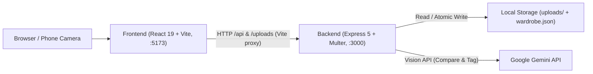

# Smart Closet MVP

A mobile-first web application designed to prevent impulse clothing buys by comparing store items against your existing wardrobe using AI vision.

## 1. What this is

The smallest version that actually solves the problem is a web app where the user can save photos of their clothes (auto-tagged by an AI Vision API) and upload a photo of a new item while shopping to instantly see if they already own something similar. It is built for people with full closets who want more structure, save money, and avoid buying duplicate or nearly identical clothes.

### Core Tasks & Backlog Status

**P0 — Core MVP (Must-Have):**

- **Task 1: Wardrobe capture (Local storage)** — _Done._ Users can upload or take a photo of a clothing item, stored locally with metadata (title, note, tags).
- **Task 3: "Do I own this?" shopping upload** — _Done._ Photograph or upload a new item while in a store and submit it for visual comparison.
- **Task 5: AI visual comparison & reason generation** — _Done._ Sends the new photo alongside closet photos to Gemini Vision to evaluate differences in cut, material, and color.
- **Task 6: Detailed results display** — _Done._ Displays the shopping item alongside matching wardrobe items with clear textual explanations.

**P1 — Important Enhancements:**

- **Task 2: Auto-tagging & category extraction** — _Implemented (Google Gemini, `gemini-3.5-flash`)._ Extracts category, sub-type, and color tags when saving an item.
- **Task 7: Wardrobe gallery & deletion** — _Partially done._ The 2-column wardrobe gallery is live; item deletion is not implemented yet.
- **Task 8: Edge cases & fallback handling** — _Done._ Handles empty wardrobes, unsupported file formats (415), 0-byte/oversized files (400/413), and API timeouts without crashing.

_(Note: **Task 4** from the initial Week 2 draft—category-based candidate pre-filtering—was intentionally omitted from the MVP because comparing all saved closet photos in a single request removes the need for a separate filtering pipeline.)_

---

## Architecture & Project Structure

### System Flow



### Repository Layout

```text
smart_closet_mvp/
├── frontend/                  # React 19 + Vite UI (port 5173)
│   └── src/App.jsx            # Shopping comparison form, wardrobe upload & 2-column gallery
├── backend/                   # Express 5 REST API (port 3000, decoupled from frontend)
│   ├── index.js               # Composition root (loads .env, initializes store & AI clients)
│   ├── app.js                 # Routes: GET /api/wardrobe, POST /api/wardrobe, POST /api/check
│   ├── validator.js           # File extension & MIME allow-list checks
│   ├── wardrobeStore.js       # Queued, atomic JSON persistence + image file storage
│   ├── tagger.js              # Optional AI auto-tagging upon saving
│   ├── data/                  # Local wardrobe.json (gitignored)
│   └── uploads/               # Saved garment photos (gitignored)
├── docs/                      # Architecture Decision Records (ADRs), specs & API contracts
├── run.sh                     # Installs frontend/backend deps and starts both servers
└── package.json               # Root test runner scripts (Vitest & coverage)
```

### API Endpoints

| Method | Endpoint        | Purpose                                                    |
| :----- | :-------------- | :--------------------------------------------------------- |
| `GET`  | `/api/health`   | Health check returning `{ "status": "ok" }`                |
| `GET`  | `/api/wardrobe` | Returns all saved wardrobe items (newest first)            |
| `POST` | `/api/wardrobe` | Validates & saves a garment photo (`multipart/form-data`)  |
| `POST` | `/api/check`    | Compares a shopping photo against all saved wardrobe items |

---

## 2. Before you start

To run this project on your machine, you need:

- **Node.js** (v22 or higher) and **npm** (v9 or higher)
- **Git** and a **Bash-compatible terminal** (Linux/macOS terminal, or **Git Bash / WSL** on Windows)
- A **Google Gemini API Key** (`GEMINI_API_KEY`, from Google AI Studio) for both the visual clothing comparison (`POST /api/check`) and automatic AI tagging upon saving (`POST /api/wardrobe`). Without it, both AI features are disabled, but saving still works normally (items get `aiTags: null`).

---

## 3. How to run it

> **Important:** Run **all** commands below from the **project root folder (`smart_closet_mvp/`)**. Do **not** `cd` into `backend/` or `frontend/`.

1. Clone the repository and enter the project root folder:

   ```bash
   git clone [https://github.com/Saschha/smart_closet_mvp.git](https://github.com/Saschha/smart_closet_mvp.git)
   cd smart_closet_mvp
   ```

2. Install root test dependencies (`vitest`) so `npm test` works:

   ```bash
   npm install
   ```

3. Create the backend environment file and add your Gemini API key:

   ```bash
   cat << 'EOF' > backend/.env
   PORT=3000
   GEMINI_API_KEY=your_gemini_api_key_here
   EOF
   ```

4. Make the start script executable and start both the frontend (Vite) and backend (Express) servers (this automatically runs `npm install` inside `frontend/` and `backend/`):

   ```bash
   chmod +x run.sh
   ./run.sh
   ```

   _(Windows without Bash: run `npm install --prefix backend && npm install --prefix frontend`, then start both servers in two separate terminals using `npm --prefix backend run dev` and `npm --prefix frontend run dev`.)_

5. _(Optional)_ Run the automated backend test suite and coverage check from the root folder:
   ```bash
   npm test
   npm run coverage
   ```

---

## 4. How to know it worked

- In your terminal, you will see `Backend listening on http://localhost:3000` and Vite ready at `http://localhost:5173/`.
- Open `http://localhost:5173` in your browser. You will see two main sections:
  1. **Check an Item Before Buying** at the top (an image upload field and a **"Compare with my closet"** button).
  2. **Add to Wardrobe** below it (a form for photo, title, note, and tags) followed by a 2-column gallery of your saved clothes.
- When you upload a shopping photo and click compare, you either see matching wardrobe items with reasons for **Cut, Material, and Color**, or the message: _"No similar items found in your closet! Safe to buy."_

---

## 5. What it does not do yet

- **Wardrobe deletion:** Users cannot delete or archive clothes they gave away yet (Task 7).
- **Large closet pagination/filtering:** All valid closet photos are sent in one comparison request, which can hit API request size limits if the wardrobe grows very large.
- **User accounts & cloud sync:** Everything is stored locally on disk (`backend/uploads/` and `backend/data/wardrobe.json`) for a single local user without login.
- **Frontend component tests:** Automated Vitest tests cover the backend API and logic, while React UI behavior is currently verified manually.

---

## 6. Where the decisions live

- **Product & Feature Specs:** [`spec.md`](spec.md) and [`docs/spec-task2-ai-tagging.md`](docs/spec-task2-ai-tagging.md)
- **Architecture Decision Records (ADRs):** [`docs/adr-001-ai-tagging.md`](docs/adr-001-ai-tagging.md)
- **API & Seam Contract:** [`docs/boundary-upload.md`](docs/boundary-upload.md)
- **Project & AI Collaboration Rules:** [`CLAUDE.md`](CLAUDE.md)

---

## AI Usage & Verification

- **Where AI was used:** Claude Code was used to scaffold the React + Express monorepo, extract validation/storage modules, and generate unit/API tests (`Vitest`) and initial drafts for `spec.md` and `docs/`.
- **What was personally verified:** Every architecture decision (such as synchronous vs. background tagging in `ADR-001`) was chosen manually; all generated routes, boundary checks (0-byte, oversized, and invalid MIME uploads), atomic file writes, and Gemini API comparisons were personally tested via `npm test`, `npm run coverage` (≥ 80% threshold), and manual browser runs via `./run.sh`.
