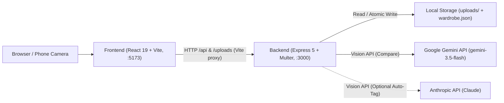

# smart-closet-mvp

A mobile-first web application designed to prevent impulse clothing buys by letting users save photos of their existing wardrobe and compare new store items against them using AI vision.

---

## 1. What this is & The MVP

**The MVP:**  
The smallest version that actually solves the problem is a web app where the user can save photos of their clothes (auto-tagged by an AI Vision API) and upload a photo of a new item while shopping to instantly see if they already own something similar.

**Who it is for & Problem it solves:**  
Built for people with full closets who struggle to remember what they already own while shopping. Instead of buying duplicate or nearly identical clothes on impulse, users get immediate, structured visual feedback comparing **cut, material, and color** so they can save money, reduce clutter, and shop more sustainably.

---

## 2. Project Scope & Backlog Status

This project follows a prioritized MVP backlog (`P0` = core hypothesis, `P1` = workflow polish & robustness).

### Core Tasks (P0 Backlog — Implemented)

- **Task 1: Wardrobe capture (Local storage)** — Users can upload or capture a photo of a clothing item (`.jpg`, `.png`, `.webp`, or camera RAW) with optional manual metadata (`title`, `note`, `tags`). Stored locally on disk (`backend/uploads/`) and indexed atomically in `backend/data/wardrobe.json`.
- **Task 3: "Do I own this?" shopping upload** — Photograph or upload a new item while in a store (`POST /api/check`) without saving it to the permanent wardrobe unless purchased.
- **Task 5: AI visual comparison & reason generation** — Sends the shopping photo alongside saved wardrobe photos to the Google Gemini Vision API with a structured prompt to evaluate differences in **cut, material, and color**.
- **Task 6: Detailed results display** — Displays matching closet items in a mobile-first grid with similarity badges (`high`, `medium`, `low`) and clear textual explanations for cut, material, and color—or confirms _"No similar items found in your closet! Safe to buy."_

### Enhancement Tasks (P1 Backlog)

- **Task 2: Auto-tagging & category extraction** _(Implemented)_ — Optionally analyzes newly saved wardrobe items via AI Vision to extract structured tags (`category`, `subType`, `color`) with graceful fallback (`aiTags: null`) if unavailable or timed out.
- **Task 7: Wardrobe gallery & deletion** _(Partially implemented)_ — The responsive 2-column wardrobe gallery is live; item deletion (`DELETE /api/wardrobe/:id`) is planned next.
- **Task 8: Edge cases & fallback handling** _(Partially implemented)_ — Handles unsupported file formats (`415`), empty/corrupted uploads (`400`), missing API keys (`503`), and comparison timeouts/errors (`502`) cleanly without crashing the UI.

---

## 3. Architecture & Project Structure

The frontend and backend are strictly decoupled across an HTTP REST boundary (`/api` and `/uploads`), allowing either side to be tested or replaced independently.

### System Flow



### API Endpoints

| Method | Endpoint        | Purpose                                                                      |
| :----- | :-------------- | :--------------------------------------------------------------------------- |
| `GET`  | `/api/health`   | Health check returning `{ "status": "ok" }`                                  |
| `GET`  | `/api/wardrobe` | Lists all saved wardrobe items (newest first)                                |
| `POST` | `/api/wardrobe` | Validates and saves a new garment photo + metadata (optional AI tagging)     |
| `POST` | `/api/check`    | Compares a temporary shopping photo against saved wardrobe images via Gemini |

### Repository Layout

```text
smart_closet_mvp/
├── frontend/                  # React 19 + Vite mobile-first web interface (port 5173)
│   └── src/
│       ├── App.jsx            # Shopping comparison form, wardrobe upload form & 2-column gallery
│       └── main.jsx           # React entry point
├── backend/                   # Node.js + Express 5 API service (port 3000)
│   ├── index.js               # Composition root (loads .env, initializes store & AI clients)
│   ├── app.js                 # Express routes, Multer memory upload & error handling
│   ├── validator.js           # File extension & MIME allow-list checks (.jpg, .png, .webp, RAW)
│   ├── wardrobeStore.js       # Serialized, atomic JSON persistence + local file storage
│   ├── geminiMatcher.js       # Structured visual comparison against closet photos via Gemini
│   ├── tagger.js              # Optional AI auto-tagging upon saving
│   ├── *.test.js              # Automated Vitest unit & API integration tests (45+ tests)
│   ├── data/                  # Local wardrobe.json (gitignored)
│   └── uploads/               # Saved garment photos (gitignored)
├── docs/                      # Architecture Decision Records (ADRs), specs & API contracts
├── spec.md                    # Core Task 1 product specification & executable checks
├── CLAUDE.md                  # Engineering conventions & AI collaboration boundaries
├── run.sh                     # Installs missing dependencies and starts both servers
└── package.json               # Root test runner scripts (Vitest & 80% coverage gate)
```

---

## 4. Before you start

To set up and run this project on your machine, you need:

- **Node.js** (v22 or higher) and **npm** (v9 or higher)
- **Git**
- A **Google Gemini API Key** (from [Google AI Studio](https://aistudio.google.com/)) for the visual clothing comparison (`POST /api/check`)
- _(Optional)_ An **Anthropic API Key** if you want automatic AI tagging when saving clothes (`POST /api/wardrobe`); without it, wardrobe saving still works normally.

---

## 5. How to run it

Run these commands in order from your terminal:

1. **Clone the repository and enter the project folder:**

   ```bash
   git clone https://github.com/Saschha/smart_closet_mvp.git
   cd smart_closet_mvp
   ```

2. **Configure environment variables in `backend/.env`:**

   ```bash
   cat << 'EOF' > backend/.env
   PORT=3000
   GEMINI_API_KEY=your_gemini_api_key_here
   EOF
   ```

3. **Start both the backend and frontend servers:**
   _(This script automatically checks for `node_modules` in `backend/` and `frontend/`, installs them if missing, and launches both processes.)_

   ```bash
   ./run.sh
   ```

4. **Run the automated test suite and verify code coverage (80% threshold):**
   ```bash
   npm test
   npm run coverage
   ```

---

## 6. How to know it worked

- **Terminal output:** You will see `Backend listening on http://localhost:3000` and Vite serving the frontend at `http://localhost:5173/`.
- **Browser UI (`http://localhost:5173`):** You will see two main sections:
  1. **Check an Item Before Buying** at the top — an image upload field (`camera` on mobile or file picker on desktop) and a **"Compare with my closet"** button.
  2. **Add to Wardrobe** below it — an upload form for photo, title, note, and tags, followed by a 2-column thumbnail gallery of your saved clothes.
- **End-to-end check:** After saving 1–2 items to your wardrobe, upload a similar item in the top section and click **"Compare with my closet"**. You should see matching items appear with a similarity badge (`high`/`medium`/`low`) and detailed reasons for **Cut**, **Material**, and **Color** (or _"No similar items found in your closet! Safe to buy."_ if nothing matches).

---

## 7. What it does not do yet

- **Wardrobe item deletion (Task 7):** Users cannot delete or archive clothes they gave away via the UI yet.
- **Large wardrobe scaling / pre-filtering:** All valid saved closet photos are sent in one comparison request to Gemini, which can approach payload size limits as a wardrobe grows very large.
- **User accounts & cloud sync:** Data is stored locally on disk (`backend/uploads/` and `backend/data/wardrobe.json`) for a single local user without authentication.
- **Automated frontend component tests:** Automated Vitest tests cover the backend API, storage, validation, and AI matcher; React UI behavior is currently verified manually.

---

## 8. Where the decisions live & AI Usage

### Engineering Artifacts

- **Product & Feature Specs:** [`spec.md`](spec.md) and [`docs/spec-task2-ai-tagging.md`](docs/spec-task2-ai-tagging.md)
- **Architecture Decision Records (ADRs):** [`docs/adr-001-ai-tagging.md`](docs/adr-001-ai-tagging.md)
- **API & Seam Contract:** [`docs/boundary-upload.md`](docs/boundary-upload.md)
- **Engineering & Scope Rules:** [`CLAUDE.md`](CLAUDE.md)

### How AI Was Used & Verified

- **Implementation & Refactoring:** Claude Code was used to scaffold Express routes, atomic JSON storage (`wardrobeStore.js`), Gemini structured-output integration (`geminiMatcher.js`), and Vitest test suites under strict spec and boundary constraints.
- **Human Verification:** Every AI-generated change was reviewed against `spec.md` and `docs/boundary-upload.md`, tested via automated Vitest suites (`npm test` / `npm run coverage` ≥ 80%), and manually verified end-to-end with real clothing photos across Gemini, Claude, and Copilot vision models.
