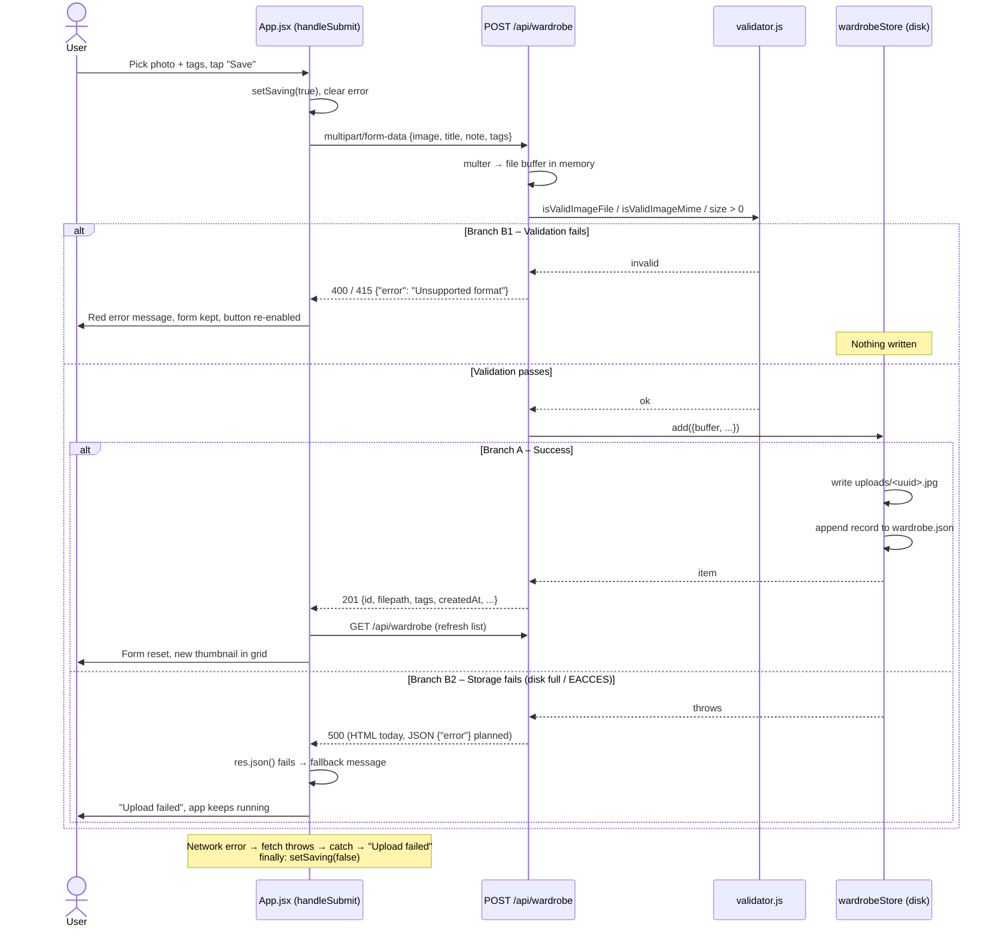

# Worksheet Steps 6–7: The Upload Boundary

**Boundary:** Frontend upload form (`frontend/src/App.jsx` → `handleSubmit`) ⇄ Backend storage API (`backend/app.js` → `POST /api/wardrobe`)

Items marked **(planned)** are part of the target contract but not implemented yet.

## 1. The Contract

| Aspect | Contract |
|---|---|
| **Who calls** | `App` React component, in `handleSubmit()`. The user submits the "Save to wardrobe" form. |
| **Who answers** | Express route `POST /api/wardrobe` in `backend/app.js`. Multer parses the upload, `validator.js` checks it, and `wardrobeStore.add()` saves it. |
| **What goes across** | `Content-Type: multipart/form-data; boundary=…` (the browser sets this through `new FormData(form)`).<br>Body fields:<br>• `image` (file, **required**): `.jpg .jpeg .png .webp` or camera RAW (`.dng .cr2 .nef .arw .orf .rw2 .raw`); MIME `image/*` or `application/octet-stream`<br>• `title` (string, optional)<br>• `note` (string, optional)<br>• `tags` (comma-separated string, optional) |
| **Success** | **`201 Created`**<br>`{ "id": "uuid", "filename": "uuid.jpg", "filepath": "/uploads/uuid.jpg", "title": "Blue Linen Shirt", "note": "", "tags": ["summer","linen"], "aiTags": { "category": "top", "subType": "button-down shirt", "color": "light blue" }, "createdAt": "2026-10-08T10:00:00.000Z" }`<br>`filepath` is the image URL, served statically from `/uploads`.<br>**(planned, Task 2)** `aiTags` holds the AI tags: three trimmed lowercase strings, `category` ∈ `top, bottom, dress, outerwear, shoes, accessory, other`. It is `null` when tagging failed, timed out, was skipped or is disabled. A tagging failure never changes the status: it is still `201`. Items saved before Task 2 have no `aiTags` field. See `docs/spec-task2-ai-tagging.md`. |
| **⚠ Failure: validation** | All errors use the same shape: **`{ "error": "<human-readable message>" }`**<br>• `400`: no `image` field → `"No image provided"`<br>• `415`: wrong extension or MIME (e.g. `notes.pdf`) → `"Unsupported format"`<br>• `400`: 0-byte file → `"Image is empty or unreadable"`<br>• `413` **(planned)**: file > 5 MB → `"Image is too large (max 5 MB)"`<br>Guarantee: nothing is written to disk. Multer keeps the file in memory until validation passes. |
| **⚠ Failure: server** | • `500`: storage write fails (disk full, `EACCES`, corrupt `wardrobe.json`).<br>Today, Express 5 catches the rejected promise and returns its default **HTML** 500 page. **(Planned):** an error middleware that returns `{ "error": "Could not save item, please try again" }`.<br>• Network failure (server down): `fetch` throws and there is no response at all. |
| **Caller's obligation on failure** | Read `body.error` if it is there. Otherwise show the generic `"Upload failed"`. Never crash. Keep the form contents so the user can retry. |

## 2. Sequence & Diagram



Plain-text version:

```
User taps Save
   │
   ▼
UI: FormData{image,title,note,tags} ──POST /api/wardrobe──► multer (memory)
                                                        │
                                                 validator checks
                                      ┌─────── fail ────┴──── pass ───────┐
                                      ▼                                   ▼
                          400/415 {"error": "..."}             store.add(): write image,
                          (nothing on disk)                    append wardrobe.json
                                      │                      ┌── ok ──┴── throws ──┐
                                      │                      ▼                     ▼
                                      │              201 {id,filepath,...}   500 (disk full)
                                      ▼                      ▼                     ▼
                 [B] UI shows body.error,       [A] UI resets form,   [B] UI shows "Upload failed"
                     form kept, no crash            refreshes grid        no crash
```

## 3. Pair Explanation (≈3 minutes)

> "The boundary I'm describing is the one between our upload form and the backend's save endpoint.
>
> **Only one thing crosses it:** one HTTP request, `POST /api/wardrobe`, as `multipart/form-data`. It has one required field, `image`, which holds the photo. It has three optional text fields: `title`, `note` and `tags`. Tags travel as a comma-separated string. That's the entire input.
>
> **On success** the server answers `201 Created` with the saved item as JSON: an `id`, a `filepath` that works directly as an image URL, the cleaned-up title, note and tags as an array, and a `createdAt` timestamp.
>
> **On failure** the reply always has the same shape: an error status plus `{ "error": "message" }`. A missing image is 400. A PDF or Photoshop file is 415, "Unsupported format". An empty file is 400. If the disk is full, that's a 500. The rule the backend promises is that a failed validation writes nothing to disk. The rule the frontend promises is that it never crashes. It shows the server's `error` message if there is one, otherwise a generic 'Upload failed', and it keeps the user's form so they can try again.
>
> **Why each side can be rewritten independently:** the frontend knows nothing about Multer, the uploads folder or `wardrobe.json`. It only knows the URL, the field names and the response shape. We could move storage to SQLite or S3 tomorrow and the UI wouldn't change, as long as `filepath` still points to a viewable image. The backend, in turn, doesn't know it's talking to React. A curl command, a test, or a future mobile app sends the same request and gets the same answer. That's why `app.test.js` can test the backend with no browser at all. As long as both sides keep this contract, either side can be thrown away and rebuilt."

---

## "Done when" check

- ✅ The contract has two failure rows (validation, and server/network) with status codes and the error JSON schema.
- ✅ The diagram has failure branches B1 (validation) and B2 (storage) next to success branch A, and the UI handles them without crashing.

## Gaps between this contract and the code

These are not fixed yet; each one would be its own ticket.

1. **No 5 MB limit yet.** Adding `limits: { fileSize: 5 * 1024 * 1024 }` to Multer, plus a handler that returns 413, would make it real.
2. **A 500 returns HTML, not JSON.** The UI's `.catch(() => ({}))` falls back to "Upload failed", so it doesn't crash. Still, a JSON error middleware would make the contract hold everywhere.
3. **A failure can be half-written.** `store.add` writes the image before it writes `wardrobe.json`. If the second write fails, the image is left on disk with no record pointing to it.
